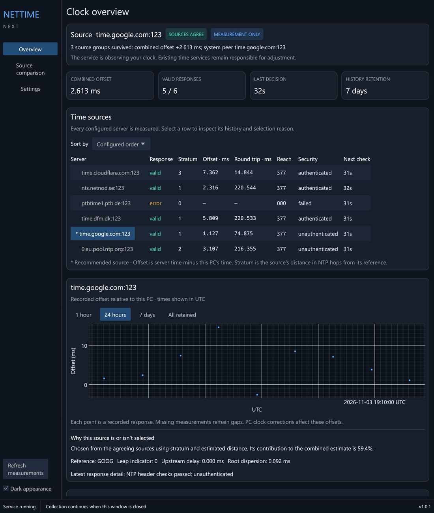
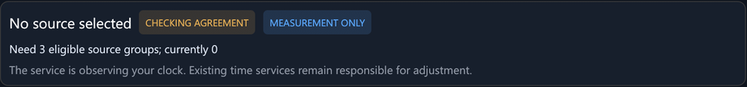

# Installation

## Download and verify

1. Open the [Releases page](https://github.com/optimusprime-nn/nettime-next/releases)
   and download the installer (`NetTimeNext-<version>-Setup-x64.exe`) and
   `SHA256SUMS.txt` from the latest release.
2. Check the installer's hash before running it:

   ```powershell
   Get-FileHash .\NetTimeNext-1.1.1-Setup-x64.exe -Algorithm SHA256
   ```

   The hash must match the line for that file in `SHA256SUMS.txt`.

The installer is not code-signed. Windows SmartScreen may warn about an
unknown publisher. Verifying the hash is how you confirm the file is the one
that was published.

## Install

Run the installer and approve the administrator prompt. It offers two
options:

- **Start the Windows service automatically (measurement mode).** This
  registers and starts the background service. Leave it on unless you only
  want the desktop app.
- **Start in the system tray when signing in.** This adds a tray icon at
  sign-in.

The installer doesn't need Python, a .NET runtime or a Visual C++
redistributable. Both programs are self-contained.

A new install only measures and does not change the clock. To let it set the
time, see [Taking over the clock](Taking-over-the-clock).

## The desktop app and tray



*The desktop app. The status bar at the bottom shows whether the service is running.*

- **Minimise** keeps the window on the taskbar.
- **X** hides the window in the notification area. Click the clock icon to
  bring it back.
- **Right-clicking the tray icon** gives Open, Settings and Exit desktop app.
- **Exit desktop app** closes the window and tray icon only. The service
  keeps running and keeps controlling the clock if it owns it.
- **Opening NetTime Next again**, from the Start menu or a shortcut, brings
  the running window forward instead of opening a second copy.

The desktop app only reads the service's data. Closing it never stops
measurement.

## First run

After installing, each source needs several measurements before it can be
used. With the default 64-second check interval, filters usually settle in
about 8–10 minutes. Until then the overview shows sources as warming up.
This is expected.



*Straight after the first start, before the filters have settled.*

## Upgrade

Run a newer installer over the existing one. An upgrade keeps:

- your sources and settings,
- history,
- the service account, start type and running state,
- clock ownership, if NetTime Next controls the clock.

During an upgrade the service pauses, the files are replaced, and then the
service resumes. An upgrade never quietly hands the clock back to another
time service. After an upgrade the filters settle again, so expect a few
minutes of warm-up before correction resumes.

Close the desktop app before upgrading. If it is still open, the installer
may not be able to replace its files.

## Uninstall

Use **Uninstall NetTime Next** from the Start menu or from Windows'
Installed apps list. Uninstalling:

- stops and removes the service,
- restores the clock services that were running before takeover, if
  NetTime Next owned the clock,
- leaves settings and history in place in `ProgramData`, so you can inspect
  or reuse them. Delete the folder yourself if you don't want them.

If the uninstaller reports that the service could not be removed safely,
open the app, use **Restore previous clocks…** under Settings > Clock
control, then uninstall again.

## Where files live

| What | Location |
| --- | --- |
| Programs | `C:\Program Files\NetTime Next` (an existing install keeps its original folder) |
| Settings | `C:\ProgramData\NetTimeNextNativePreview\settings.json` |
| History database | `C:\ProgramData\NetTimeNextNativePreview\data\history.sqlite3` |
| Service error log | `C:\ProgramData\NetTimeNextNativePreview\data\service-error.log` |
| Result of the last administrator action | `C:\ProgramData\NetTimeNextNativePreview\admin-result.json` |
| Clock ownership journal | `C:\ProgramData\NetTimeNextNativePreview\clock-ownership.json` |
| Reports you export | `Documents\NetTime Next Reports` |

The Windows service is named `NetTimeNextNativePreview` and runs as the
virtual account `NT SERVICE\NetTimeNextNativePreview`. The word "Preview" in
these internal names is historical. They are kept so that existing
installations keep their ownership and history across upgrades.

Edit settings through the app rather than editing `settings.json` by hand.
The app validates changes, tests new sources and rolls back a failed update.
