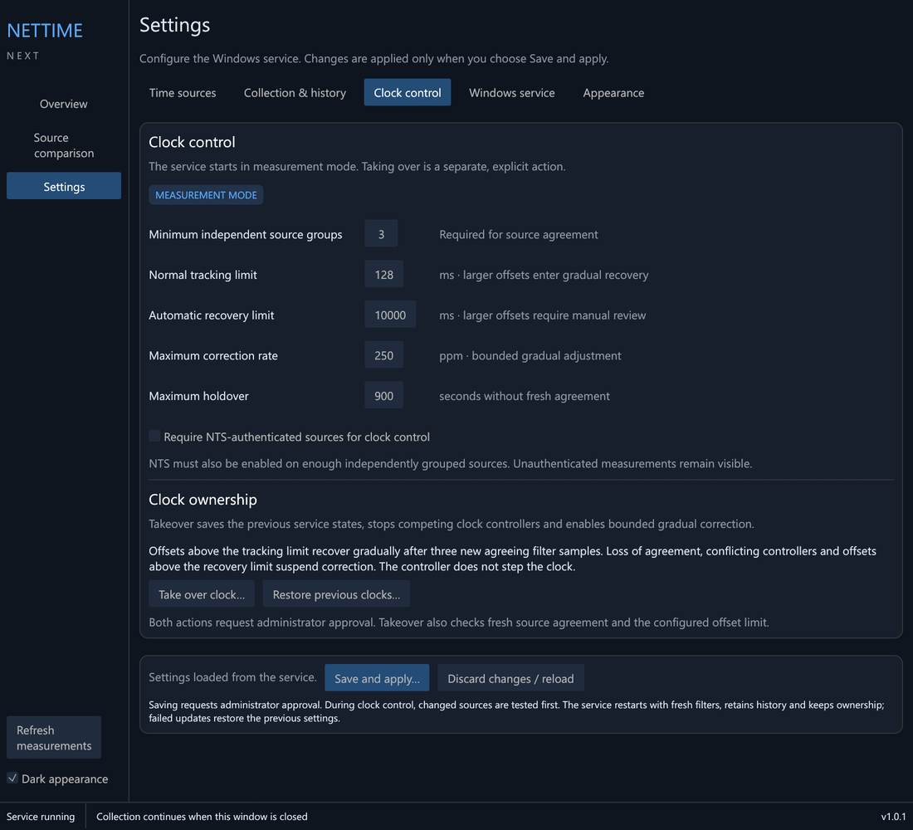
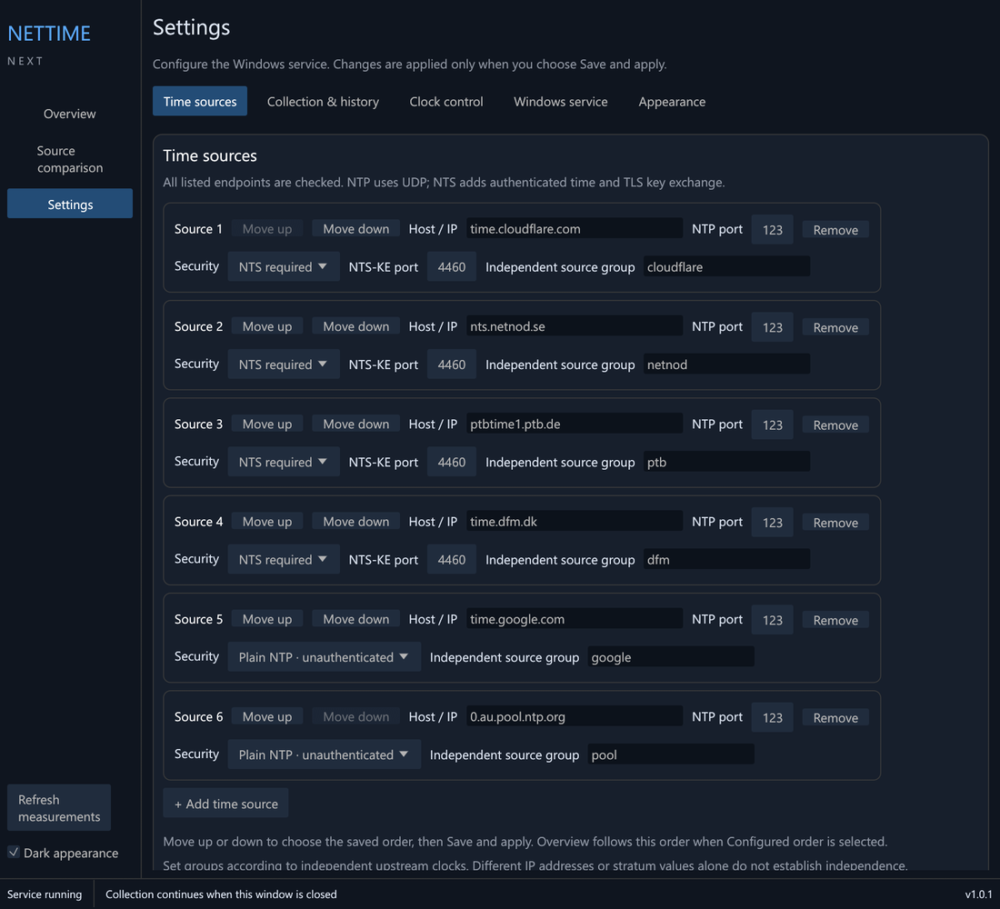
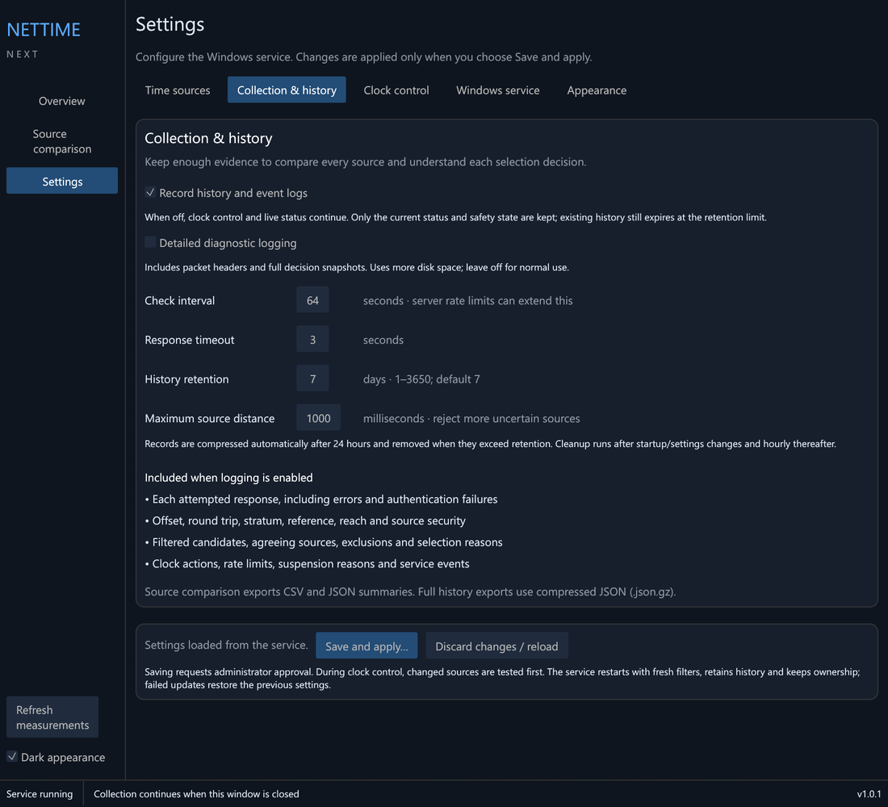
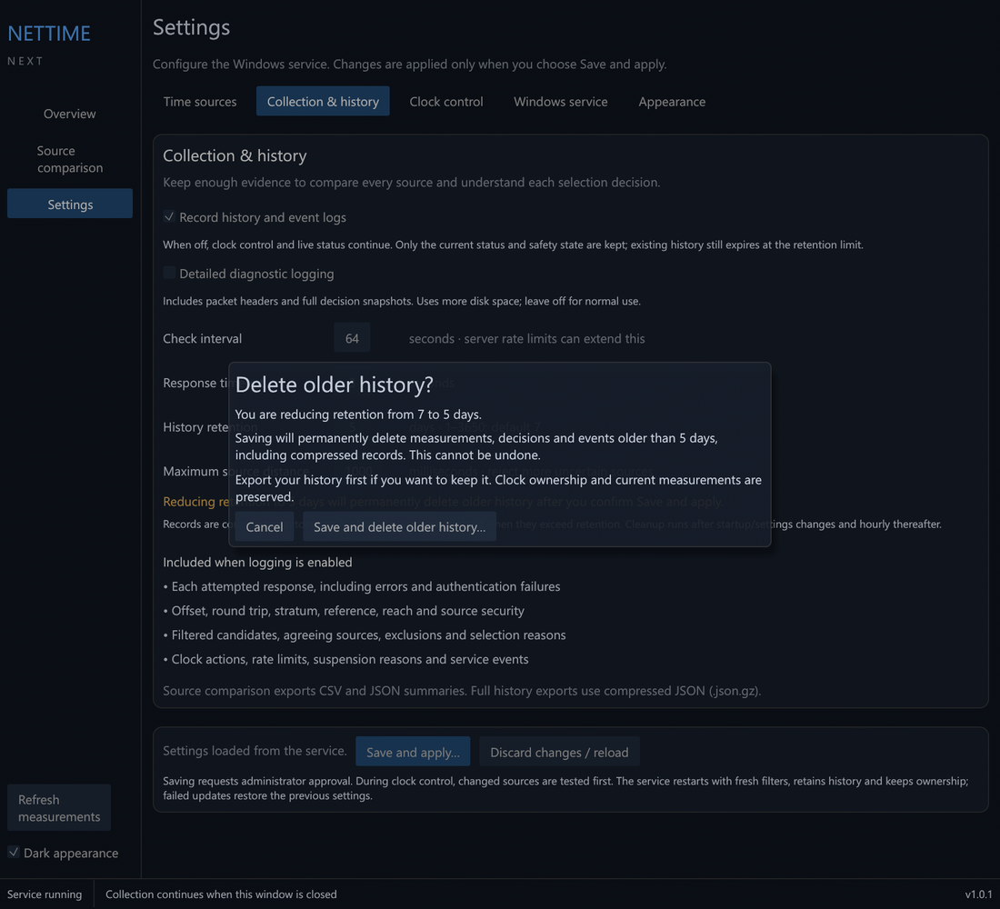
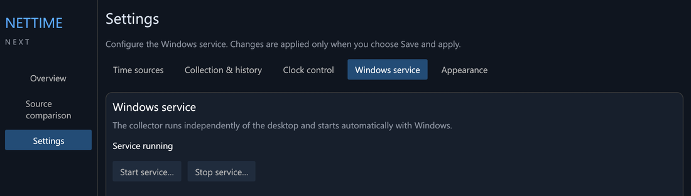
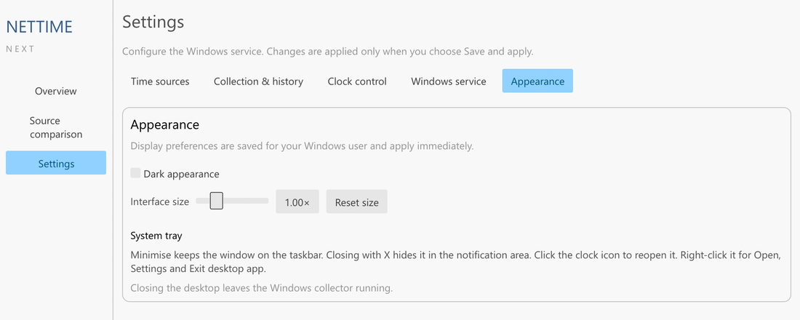

# Settings reference

Change settings in the app under **Settings**, then choose **Save and
apply…**. Saving needs administrator approval.

*Settings is split into tabs. Save and apply is at the bottom of each one.*

When you apply settings:

1. the new settings are validated,
2. changed sources are tested before anything is replaced, if the service
   controls the clock,
3. the service restarts with fresh filters. History and clock ownership are
   kept.

If a source check fails, the running service is left untouched. If the
update fails part-way, the previous settings are restored. **Discard
changes / reload** throws away unsaved edits.

The settings are stored in `C:\ProgramData\NetTimeNextNativePreview\settings.json`.
The JSON key for each setting is shown below for reference.

## Time sources

*Settings > Time sources.*

| Setting | Key | Default | Allowed |
| --- | --- | --- | --- |
| Server name | `servers[].host` | | Host name or IP address, up to 253 characters |
| NTP port | `servers[].port` | 123 | 1–65535 |
| Security | `servers[].security` | `nts_required` for the defaults, `plain_ntp` for new entries | `nts_required` or `plain_ntp` |
| NTS-KE port | `servers[].nts_ke_port` | 4460 | 1–65535 |
| Independent source group | `servers[].source_group` | | Up to 100 characters, case-insensitive |

You can have 1–32 sources. The same host and port can't be listed twice.

## Clock and selection

| Setting | Key | Default | Allowed | What it does |
| --- | --- | --- | --- | --- |
| Check interval | `poll_seconds` | 64 s | 64–131072 s | How often each source is polled. |
| Response timeout | `timeout_seconds` | 3 s | 0.1–30 s | How long to wait for a reply. |
| Maximum source distance | `max_distance_ms` | 1000 ms | 1–10000 ms | A source whose root distance is above this can't be selected. |
| Minimum independent source groups | `clock.min_sources` | 3 | 3–32 | How many groups must agree before the clock is corrected. |
| Require NTS-authenticated sources for clock control | `clock.require_nts` | off | on/off | When on, only NTS-authenticated sources vote. |

## Clock control

| Setting | Key | Default | Allowed | What it does |
| --- | --- | --- | --- | --- |
| Mode | `clock.mode` | `observe` | `observe` or `slew` | Set by **Take over clock…** and **Restore previous clocks…**. Don't edit it by hand. |
| Normal tracking limit | `clock.max_offset_ms` | 128 ms | 1–128 ms | Offsets up to this are corrected normally. |
| Automatic recovery limit | `clock.max_recovery_offset_ms` | 10000 ms | from the tracking limit up to 60000 ms | Larger offsets are recovered gradually up to this limit. Beyond it, correction suspends. |
| Maximum correction rate | `clock.max_slew_ppm` | 250 ppm | 1–500 ppm | The fastest the clock is sped up or slowed down. |
| Maximum holdover | `clock.holdover_seconds` | 900 s | 64–3600 s | How long the current rate is held without a fresh agreeing sample before correction suspends. |

## Collection & history

*Settings > Collection & history. Check interval, response timeout and maximum source distance are set here too.*

| Setting | Key | Default | Allowed | What it does |
| --- | --- | --- | --- | --- |
| Record history and event logs | `logging_enabled` | on | on/off | When off, clock control and live status continue but no history is recorded. |
| Detailed diagnostic logging | `diagnostic_logging` | off | on/off | Records packet headers and full decision snapshots. Uses much more disk space. |
| History retention | `retention_days` | 7 days | 1–3650 days | Records older than this are deleted. |

Reducing retention deletes older data permanently, so the app asks you to
confirm (**Save and delete older history…**). Export first if you want to
keep it; see [History and exports](History-and-exports).

*Reducing retention asks before anything is deleted.*

## Other settings pages

*Settings > Windows service.*

- **Windows service**: shows the service state and has **Start service…**
  and **Stop service…**.
- **Appearance**: dark or light theme, and interface size.
- **System tray**: how minimise and close behave.

*Settings > Appearance, in the light theme.*
