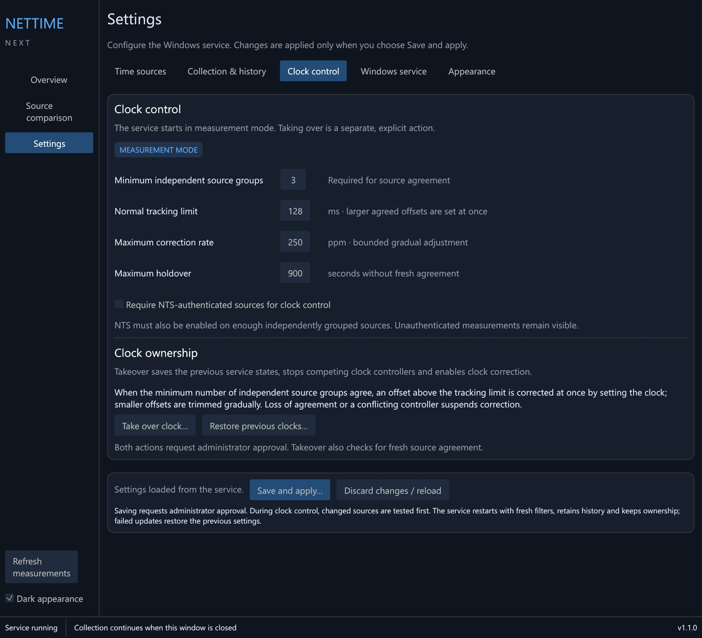
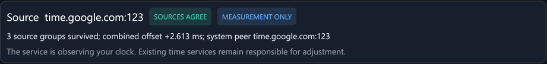

# Taking over the clock

## Measurement mode

A new installation starts in measurement mode. It polls every source,
records the results and works out what it *would* do, but it doesn't touch
the Windows clock. Whatever already sets your clock, such as Windows Time,
keeps doing so.

Measurement mode is a good way to compare sources before trusting them. It
also lets you see how far your current clock is from them.

## Before you take over

Check these on the **Overview** page:

- At least three **independent source groups** are qualified. This is the
  default minimum. A group is a set of endpoints that share an upstream
  clock; see [Time sources and NTS](Time-sources-and-NTS).
- The sources **agree** with each other. The overview reports
  "SOURCES AGREE" once they do.
- The filters have **settled**, which takes about 8–10 minutes after the
  service starts or settings change.

## Take over

Open **Settings > Clock control** and choose **Take over clock…**, then
approve the administrator prompt.



*Settings > Clock control, in measurement mode.*

Takeover is done as one recorded transaction:

1. The current state of the other clock services is saved to an ownership
   journal. These are Windows Time (`W32Time`), the original NetTime service
   (`NetTimeSvc`) and the older NetTime Next service (`NetTimeNext`).
2. Those services are stopped and set to Disabled so they can't fight over
   the clock.
3. The NetTime Next service account is given the right to adjust the system
   time.
4. The service restarts in correction mode.

If any step fails, everything done so far is undone and the clock stays
with whatever had it before.

Correction begins once the filters settle again. While correcting, the
overview shows "GRADUAL CLOCK CORRECTION".

## While it owns the clock

- The service checks continuously that no other controller has started. If
  one has, it stops correcting rather than fighting it.
- Changing settings keeps ownership. Changed sources are tested before the
  service restarts, and a failed update restores the previous settings.
- Upgrades keep ownership.

## Hand the clock back

Open **Settings > Clock control** and choose **Restore previous clocks…**,
then approve the administrator prompt.

This puts back the other services exactly as they were recorded at takeover,
with the same start types and running state. It also removes the clock right
from the NetTime Next account and returns the service to measurement mode.
Uninstalling does the same automatically.

From the command line, as administrator:

```powershell
& "C:\Program Files\NetTime Next\NetTimeNextNativeService.exe" --rollback
```

## What the overview states mean



*The state badges appear at the top of the overview.*

| State | Meaning |
| --- | --- |
| MEASUREMENT MODE / MEASUREMENT ONLY | Not controlling the clock. |
| CLOCK FILTER SETTLING | Controlling the clock, but waiting for enough fresh samples. Normal after a start or restart. |
| GRADUAL CLOCK CORRECTION | Steering the clock towards the agreed time. |
| CLOCK SET TO AGREED TIME | The sources agreed the clock was more than the tracking limit out, and it was set to the agreed time. |
| WAITING FOR FRESH SAMPLE | Holding the current rate until a new measurement arrives. |
| CORRECTION SUSPENDED | Stopped correcting. The reason is shown underneath. |
| CLOCK STATE NEEDS CHECKING | Ownership or service state is not what was expected. See [Troubleshooting](Troubleshooting). |
