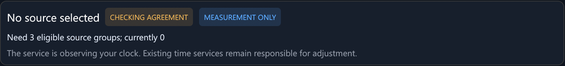

# Troubleshooting

Start with the **Overview** page. The **Selection explanations** panel gives
a reason for every source that isn't selected. For anything else, check:

- `C:\ProgramData\NetTimeNextNativePreview\admin-result.json`: the outcome of
  the last install, settings, takeover or rollback action,
- `C:\ProgramData\NetTimeNextNativePreview\data\service-error.log`: errors
  that stopped the service,
- `NetTimeNextNativeService.exe --health`: current state as text.

## "Need 3 eligible source groups; currently 0"

*How this looks on the overview.*

Shortly after a start, restart, upgrade or settings change, this is normal.
Each source needs about four fresh samples, which takes 8–10 minutes at the
default 64-second interval.

If it persists, look at each source's reason:

| Reason | What to do |
| --- | --- |
| Root distance … exceeds limit; filter warming or source uncertain | If the service has just started, wait. Otherwise the source is too far away or too unstable. Check its round trip, or raise **Maximum source distance**. |
| Filter warming: need four fresh measurements | Wait. |
| Assign independent source group | Give the source a group (see [Time sources and NTS](Time-sources-and-NTS)). |
| Same source group | This source shares a group with a better one. That's expected. |
| Clock policy requires NTS | The source is plain NTP and NTS is required for clock control. |
| Latest response expired / No current response | The source isn't answering. Check the network, firewall and host name. |
| NTS errors | See "NTS sources fail" below. |

If fewer sources answer than the minimum number of groups, add more
independent sources.

## Sources don't agree

If one source is far from the others, the intersection step rejects it as a
falseticker and the rest carry on. If sources split into two camps with no
majority, correction suspends. Check each source's reference (stratum,
upstream). Sources fed by the same upstream should share a group.

## NTS sources fail

- **Firewall**: NTS needs outbound TCP 4460 (key exchange) as well as UDP
  123.
- **Clock far off**: if the PC's date is wrong by days or more, TLS
  certificate checks fail. Correct the date manually once, then let
  NetTime Next take over.
- **TLS inspection**: proxies or security software that intercept TLS break
  certificate validation. NTS can't work through them.
- **Server-side problems**: a failed key exchange is retried with backoff.
  Check whether the operator reports an outage.

## "CORRECTION SUSPENDED"

The reason is shown under the heading:

| Reason | Meaning |
| --- | --- |
| Offset exceeds automatic recovery limit; manual review required | The clock is further off than the recovery limit (10 s by default). Set the time manually, or raise **Automatic recovery limit** if you trust the sources, and correction resumes. |
| Filtered sample expired | No fresh agreeing sample within **Maximum holdover**. The clock is back at its neutral rate. It resumes when sources return. |
| Leap announcement | A source announced a leap second. Correction resumes after it. |
| Need N eligible source groups | See above. |

## "CLOCK STATE NEEDS CHECKING" or an ownership conflict

Another time service started while NetTime Next owned the clock, for example
Windows Time started by a policy or another utility. NetTime Next stops
correcting rather than fighting it.

- Find what started it. Group Policy or domain time settings can restart
  `W32Time`.
- To keep NetTime Next in charge, stop and disable the other service. Then
  restart the NetTime Next service from **Settings > Windows service**.
- To give up control, use **Restore previous clocks…**.

On a domain-joined PC, domain policy usually expects `W32Time` to keep time.
Check with whoever manages the domain before taking over.

## The installer says applications are using its files

Close the desktop app, including the tray icon (**Exit desktop app**), and
run the installer again.

## The desktop app shows "Service not installed" or "Service stopped"

Open **Settings > Windows service** and choose **Start service…**. If it
stops again, check `service-error.log`.

## The clock wanders by several milliseconds

Some wander right after a restart is normal while the frequency estimate
settles. That usually takes an hour or two. If it persists:

- Check whether the system peer keeps changing between sources with
  different offsets. Grouping sources that share an upstream helps.
- Prefer nearby sources with low round trips.
- Look at **Source history** for sources with large jitter.

## Reporting a problem

Open an issue at
<https://github.com/optimusprime-nn/nettime-next/issues> with:

- the NetTime Next version (Settings, or `--version`),
- the Overview state and reasons,
- the relevant part of `--health` output.

**Remove private host names and IP addresses before posting.** Don't attach
your history database or settings file publicly, because they contain your
source list and network details.
