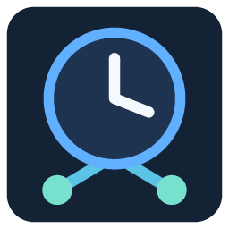
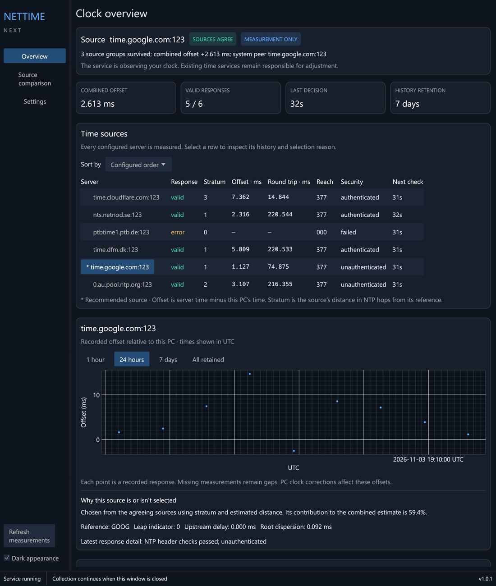

# NetTime Next

NetTime Next keeps a Windows PC's clock accurate using several network time
sources at once, and shows you the evidence for every decision it makes.

It runs as a native Windows service, with a desktop app and a tray icon for
watching it. It is a client only: it sets the clock on the PC it runs on and
does not serve time to other machines.

*The overview: the current decision, the combined offset and every source's latest result.*

## What it does

- **Checks every source you configure**, not just one. For each source it
  shows the offset, round trip, stratum, reach and whether the reply was
  authenticated.
- **Uses authenticated time where it can.** It supports Network Time
  Security (NTS), and a source marked NTS-required never falls back to plain
  NTP.
- **Only corrects the clock when sources agree.** At least three independent
  source groups have to agree before it adjusts the clock.
- **Corrects the clock safely.** Small errors are trimmed gradually at a
  bounded rate. When the sources agree the clock is more than 128 ms out, for
  example after a restart, it sets the clock to the agreed time at once.
- **Starts in measurement mode.** A fresh install only watches. It takes
  control of the clock only when an administrator explicitly tells it to,
  and that can be undone.
- **Keeps a history.** Measurements, decisions and events are kept for
  seven days by default, so you can see why the clock did what it did.

## Requirements

- Windows 10 or 11, x64.
- Administrator approval to install, to change settings and to take over
  the clock.
- Network access to at least three independent time sources (UDP 123, plus
  TCP 4460 for NTS key exchange).

## Pages

| Page | What it covers |
| --- | --- |
| [Installation](Installation) | Download, verify, install, upgrade, uninstall, and where files live |
| [Taking over the clock](Taking-over-the-clock) | Measurement mode, takeover, and handing the clock back |
| [Time sources and NTS](Time-sources-and-NTS) | Choosing sources, source groups and authentication |
| [How correction works](How-correction-works) | Filtering, source selection, and how the clock is steered |
| [Settings reference](Settings-reference) | Every setting, its default and its allowed range |
| [History and exports](History-and-exports) | Retention, compression, and exporting data |
| [Command-line reference](Command-line-reference) | Administrator and diagnostic commands |
| [Troubleshooting](Troubleshooting) | Common states and what to do about them |
| [Building from source](Building-from-source) | Toolchain and packaging |
| [Scope and validation](Scope-and-validation) | What has and hasn't been tested, and the standards it follows |

## Status

The current version is 1.1.2, and the installer is unsigned. See
[Scope and validation](Scope-and-validation) for what has and hasn't been
verified.

Source code and releases: <https://github.com/optimusprime-nn/nettime-next>
